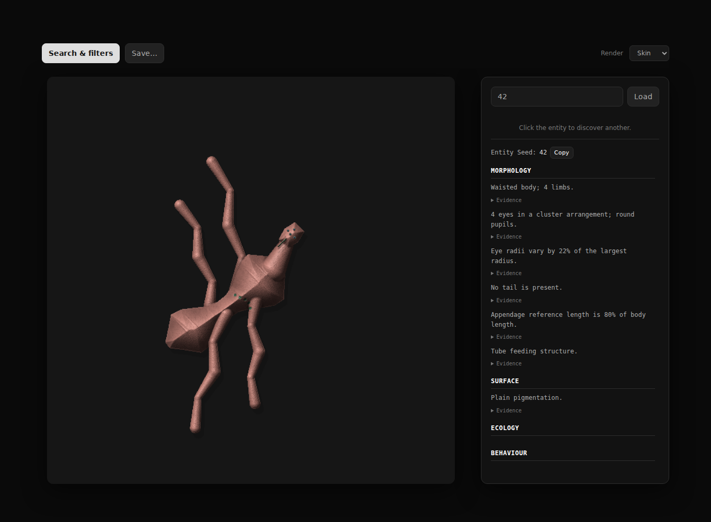
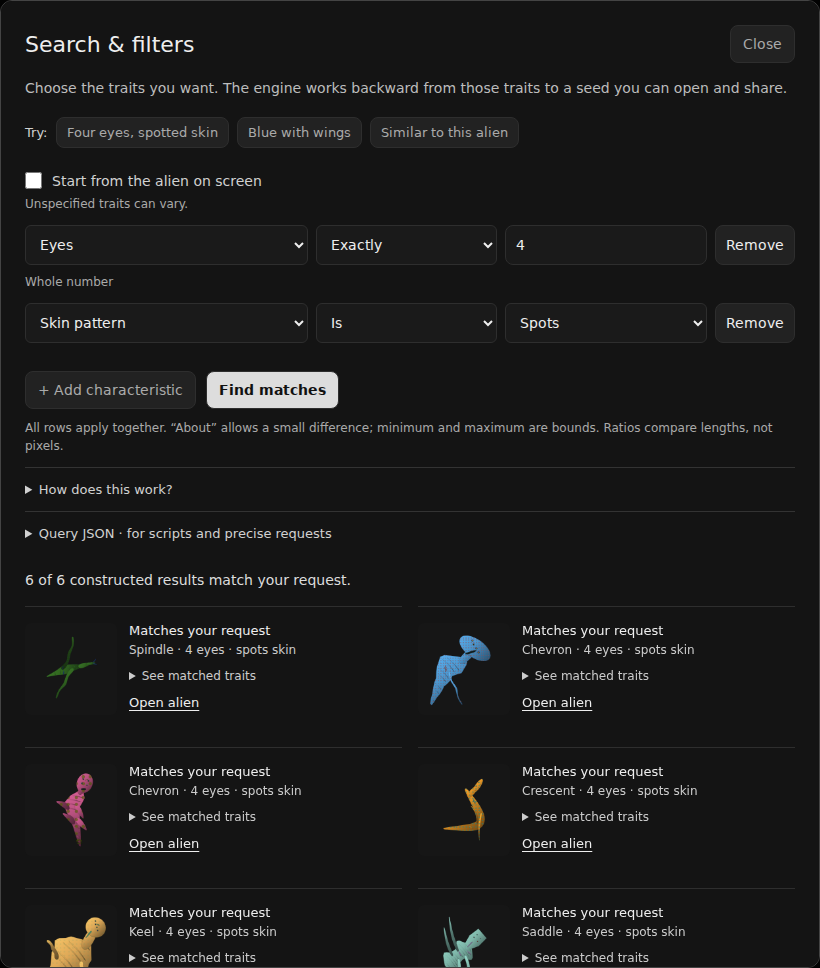

<h1 align="center">This Alien Doesn't Exist</h1>
<p align="center">A procedural alien generator with deterministic seeds and trait-based search.</p>
<p align="center"><a href="https://thisaliendoesnotexist.app">Website</a> · <a href="https://github.com/aamosm/This-Alien-Does-Not-Exist">Source</a></p>



Generate an alien from a seed, revisit it later, or search for traits. Everything runs in the browser; no account or external model is needed.

## Run

Open `index.html` for offline use. For the local server, JSON endpoints and CLI, install Node.js 22 or later and run:

```bash
npm start
```

**Quick** is the lightweight renderer; **Skin** adds surface detail and lighting. Random discovery avoids the last ten silhouette clusters even when markings differ. Wing membranes vary in sweep, chord and tip shape instead of sharing a fixed quadrilateral. Body, head and limb construction now also use the position within their genome choice intervals. This changes current-generator appearances at existing seeds; the original generator is unchanged.

## Search

Use **Search & filters** to combine traits, for example:

1. Eyes → Exactly → `4`
2. Skin pattern → Is → `Spots`
3. Colour → About → `120`

Select **Find matches**. Results show which traits matched. Some combinations of geometric constraints can only return an approximate match.



**Start from the alien on screen** finds visibly different relatives. **Keep the same body type** preserves the anatomy family; uncheck it to explore different body and head modules. The solver varies several proportions and compares outlines, so changing only paint or texture does not fill the results with copies. Restrictive filters can return fewer results. Search links can be shared; the JSON editor accepts the API query format.

Search builds genomes from the requested traits rather than scanning random seeds. See [REVERSE.md](docs/REVERSE.md) for the method and its limits.

## Combat

Expand **Combat** beside the observations to inspect eight simulation ratings and two passive abilities. Choose **Duel…**, enter another seed, and compare; ↑ marks the higher stat. Start a duel, choose actions yourself, or use **Auto resolve**. Everything runs locally and keeps the same minimal canvas layout.

Ordinary creatures share 800 total rating points. Size, proportions, limbs, sensory layout and environmental inputs create trade-offs between vitality, power, defense, dexterity, speed, intellect, resolve and recovery. These are game rules, not biological facts. There are no elemental types. A match seed makes the same matchup and action sequence reproducible. [Combat rules](docs/COMBAT.md) explain all formulas, abilities and exceptions.

The API exposes `duel('42', '3')` and `/api/duel?left=42&right=3&battle=0`. JSON records include `combat`; imported records are regenerated from their identity so supplied stats cannot override the rules.

## Seeds and saves


A creature's identity is `generatorVersion + seed`. `?v=2&seed=42` opens the current generator; `?v=1&seed=42` opens the original mapping.

The **Save…** menu exports PNG or JSON for the current creature, or JSONL for saved discoveries. Imports support JSON and JSONL. Browser storage is optional; export discoveries before clearing browser data.

## JavaScript API

`alien-api.js` is a dependency-free ES module:

```js
import { generate, search, closest } from './alien-api.js';

const alien = generate('42', { generatorVersion: 2 });
const matches = await search({
  constraints: [{ field: 'eyeCount', op: 'eq', value: 4 }],
  limit: 6
});
const relatives = await closest(alien.identity.seed, { category: 'anatomy' });
```

See [API.md](docs/API.md) for query fields, responses and server routes. GitHub Pages supports the module and browser-based `api.html` bridge, but cannot run the Node HTTP endpoints.

## Develop

```bash
npm ci
npx playwright install chromium
npm run build
npm test
npm run test:browser
npm run audit
```

`npm run package` creates `dist/This-Alien-Does-Not-Exist.zip`. Publish `index.html`, `404.html`, `.nojekyll`, `alien-api.js`, `api.html` and `LICENSE` for GitHub Pages. Keep `CNAME` only for the custom domain.

## License

[MIT](LICENSE), retaining `Copyright (c) 2026 DHC`.
